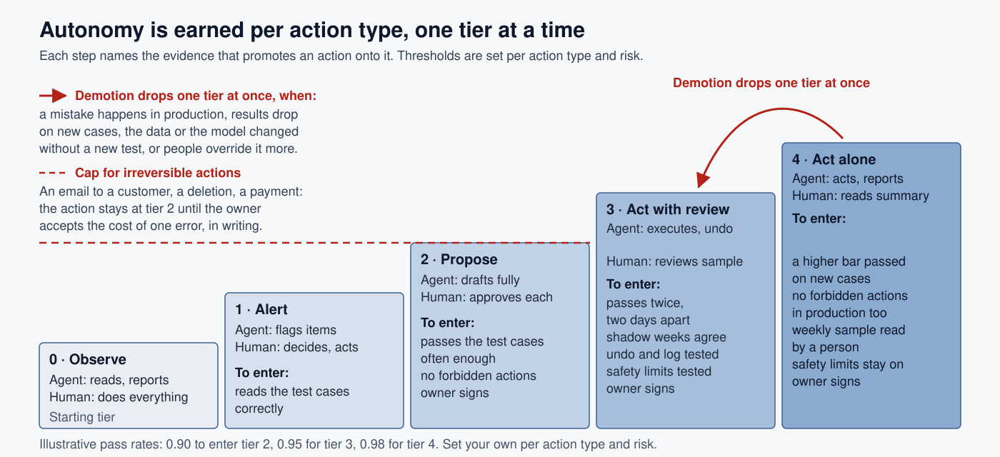
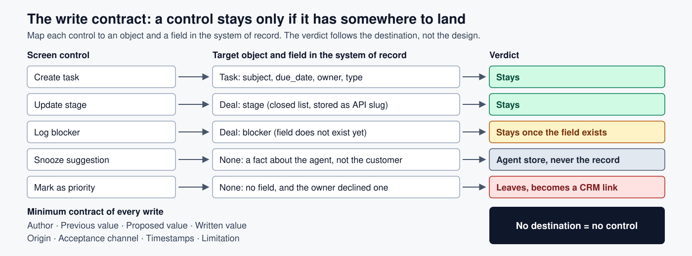

# Agent design principles

Most agent products do not fail in the demo. They fail in the second week of real use, when the person cannot tell what the agent did, a button turns out to write nothing, and nobody can say with evidence how much the agent should be allowed to do on its own.

This repo holds four design principles for products where an AI agent proposes, executes or monitors actions for a person. Each is written as a reusable skill (`SKILL.md`) for AI coding assistants, and as plain Markdown anyone can read.

All examples use a fictional company and product, Acme Field Sales Assistant, an agent that drafts follow-up emails and updates the CRM after customer meetings. No real customers, data or systems appear in this repo.

## Two pictures



*Autonomy is earned per action type, one tier at a time, on a score from a frozen set. An irreversible action stays at tier 2 until the owner accepts the cost of one error in writing.*



*A control stays only if it has somewhere to land. What is about the agent rather than the customer goes to the agent's own store. What has no destination leaves.*

## Skills

| Skill | Question it answers | What you get |
|---|---|---|
| [agentic-ux](skills/agentic-ux/SKILL.md) | How does a screen make an agent visible, controllable and reversible? | Twelve heuristics, seven required states, a 0-2 critique rubric |
| [write-contract](skills/write-contract/SKILL.md) | Does this control have somewhere to land in the system of record? | A mapping method, four verdicts, the minimum contract of a write |
| [dense-operations-ui](skills/dense-operations-ui/SKILL.md) | How should a screen look when people use it all day to decide? | Fourteen named rules, a button vocabulary, a measured audit |
| [autonomy-tiers-and-evals](skills/autonomy-tiers-and-evals/SKILL.md) | When has an agent earned more autonomy? | Five tiers, a golden set, a rubric, promotion and demotion criteria |

Every skill has the same shape: when to use it, inputs, a numbered procedure, the rules, a checklist, an Acme example with a weak and a corrected version, and a definition of done.

## Start here

**I design agent screens.** Run `agentic-ux` in `shape` mode to set the regime of every action and the states the mockup must show. Map each action with `write-contract` so nothing on the screen lacks a destination. Then render with the rules in `dense-operations-ui`.

**I decide how much an agent may do.** Read `autonomy-tiers-and-evals`. Split the agent into action types, build the golden set from real cases, set the baseline, and promote one tier at a time on evidence. The write trail from `write-contract` gives you the shadow comparison.

**I audit an existing agent UI.** Fill in [templates/screen-audit.md](templates/screen-audit.md): `agentic-ux` critique for the heuristics and states, `write-contract` audit for the controls, `dense-operations-ui` critique for density and legibility. The filled [Acme example](examples/acme-sales-assistant/screen-audit.md) shows what a complete audit reads like.

## How this connects to the backlog method

These principles are the design half of a method whose writing half lives in [backlog-writing-system](https://github.com/Benyoumen/backlog-writing-system). There, [`write-prd`](https://github.com/Benyoumen/backlog-writing-system/tree/main/skills/write-prd) sets the boundaries of an agent as Always, Ask first and Never, which become the tiers and the never-cases here. [`eval-cases`](https://github.com/Benyoumen/backlog-writing-system/tree/main/skills/eval-cases) turns acceptance criteria into golden-set cases, the input to `autonomy-tiers-and-evals`. [`agent-brief`](https://github.com/Benyoumen/backlog-writing-system/tree/main/skills/agent-brief) writes the brief an agent builds from, including the write stories that `write-contract` maps.

## Also here

- [docs/principles.md](docs/principles.md): the four ideas, how the skills connect, regimes and tiers, the diagrams
- [docs/sources.md](docs/sources.md): the public work this method builds on, and what it takes from each
- [templates/](templates): a screen audit and a write contract table
- [examples/acme-sales-assistant](examples/acme-sales-assistant): both templates, filled in

## Use

Copy a folder from `skills/` into your assistant's skills directory (for Claude Code, `.claude/skills/`), or read the files directly. Each `SKILL.md` starts with a frontmatter (`name`, `description`) that assistants use to decide when to load it.

```
skills/       4 skills, one folder each (SKILL.md plus reference notes)
templates/    screen audit, write contract table
examples/     the Acme example, both templates filled in
docs/         principles, sources
assets/       banner and the two diagrams
```

## License

MIT. See [LICENSE](LICENSE).
