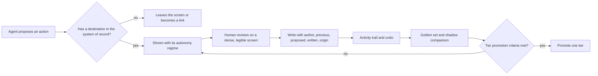
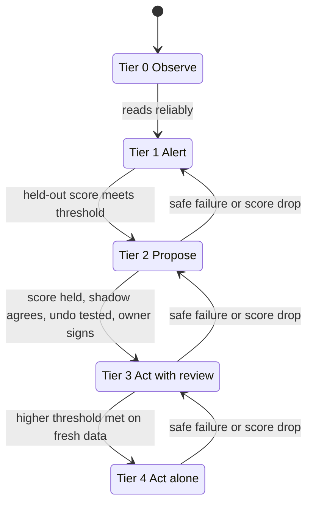

# Principles

Four ideas hold this repo together.

1. **An agent is only as useful as its screen is honest about it.** People should see what the agent did, what it will do alone and what waits for them. (`agentic-ux`)
2. **A button that changes nothing is a false promise.** Every control on an agent screen must land in the system of record or leave. (`write-contract`)
3. **A working screen is a decision tool.** It is dense, legible and quiet, and it is measured, not eyeballed. (`dense-operations-ui`)
4. **Autonomy is earned with evidence.** More autonomy follows a score on a frozen set, not a good demo. (`autonomy-tiers-and-evals`)

## How the pieces fit

## Autonomy tiers

Tiers apply per action type. An agent can act alone on one action and only propose another.

Irreversible actions have a cap at Tier 2 until the owner accepts the cost of an error in writing. Thresholds are set by the team. The examples in the skills are illustrative and fictional.

## Order of use

1. `agentic-ux` shape: set the regime of each action and the states.
2. `write-contract` map: confirm each control has a destination.
3. `dense-operations-ui` rules: design the screen.
4. `autonomy-tiers-and-evals`: decide when the agent earns the next tier.
5. `templates/screen-audit.md`: audit before review.

## Public references

- Microsoft HAX Toolkit, Guidelines for Human-AI Interaction
- Google PAIR, People + AI Guidebook
- Shape of AI, pattern library
