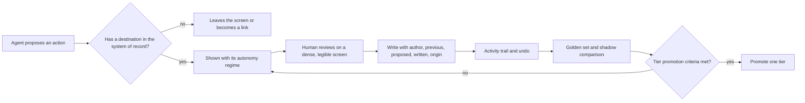
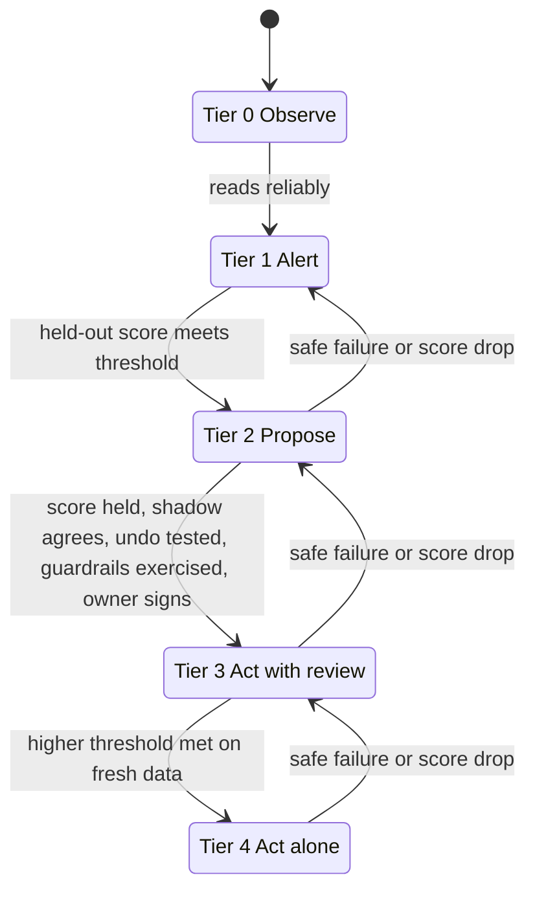

# Principles

Four ideas hold this repo together.

1. **An agent is only as useful as its screen is honest about it.** People should see what the agent did, what it will do alone and what waits for them. (`agentic-ux`)
2. **A button that changes nothing is a false promise.** Every control on an agent screen must land in the system of record or leave. (`write-contract`)
3. **A working screen is a decision tool.** It is dense, legible and quiet, and it is measured, not eyeballed. (`dense-operations-ui`)
4. **Autonomy is earned with evidence.** More autonomy follows a score on a frozen set, a shadow period and a signature, not a good demo. (`autonomy-tiers-and-evals`)

## How the pieces fit

## Regimes on the screen, tiers behind them

The screen shows three regimes, because a card can carry one signal: acts alone (filled dot), proposes and waits (half dot), alerts only (empty dot). Behind the screen, five tiers say how an action earns a regime. Tiers apply per action type. An agent can act alone on one action and only propose another.

| Tier | Name | Rendered as |
|---|---|---|
| 0 | Observe | Presence line and activity trail only |
| 1 | Alert | Alerts only |
| 2 | Propose | Proposes and waits |
| 3 | Act with review | Acts alone, with a reviewed sample |
| 4 | Act alone | Acts alone |

Irreversible actions have a cap at Tier 2 until the owner accepts the cost of an error in writing. Evals measure the average on the frozen set; guardrails stay on at every tier to protect the tail. Thresholds are set by the team, and every number in the skills is illustrative.

## The write contract in one picture

The question is a systems question, not a UX question: does this action have somewhere to land? Actions on the record go to the system of record. Responses about the recommendation (dismiss, snooze, rate) go to the agent's own store. What has neither leaves.

## Order of use

1. `agentic-ux` shape: set the regime of each action and the states.
2. `write-contract` map: confirm each control has a destination.
3. `dense-operations-ui` rules: design the screen.
4. `autonomy-tiers-and-evals`: decide when the agent earns the next tier.
5. `templates/screen-audit.md`: audit before review.

## Where the backlog comes in

The writing half of this method is [backlog-writing-system](https://github.com/Benyoumen/backlog-writing-system).

- [`write-prd`](https://github.com/Benyoumen/backlog-writing-system/tree/main/skills/write-prd) sets the boundaries of an agent as Always, Ask first and Never. They become the starting tiers and the never-cases of the golden set.
- [`eval-cases`](https://github.com/Benyoumen/backlog-writing-system/tree/main/skills/eval-cases) turns acceptance criteria into golden-set cases, the input to `autonomy-tiers-and-evals`.
- [`agent-brief`](https://github.com/Benyoumen/backlog-writing-system/tree/main/skills/agent-brief) writes the brief an agent builds from, including the write stories that `write-contract` maps.

## Public references

See [sources.md](sources.md) for the public work this method builds on and what it takes from each.
